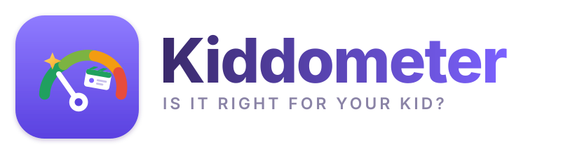
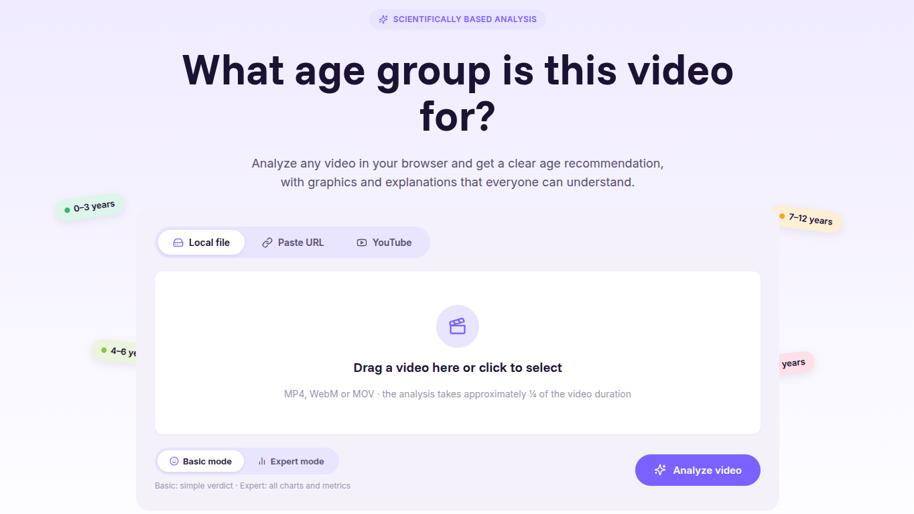
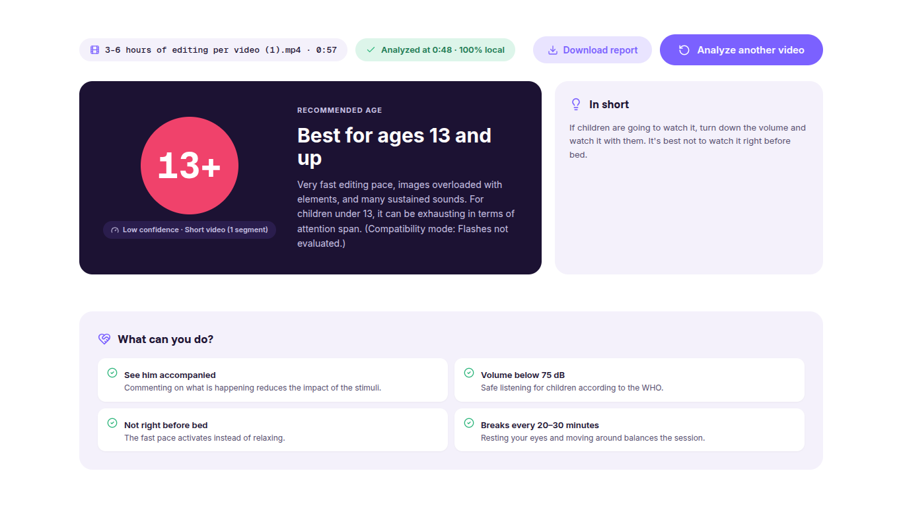
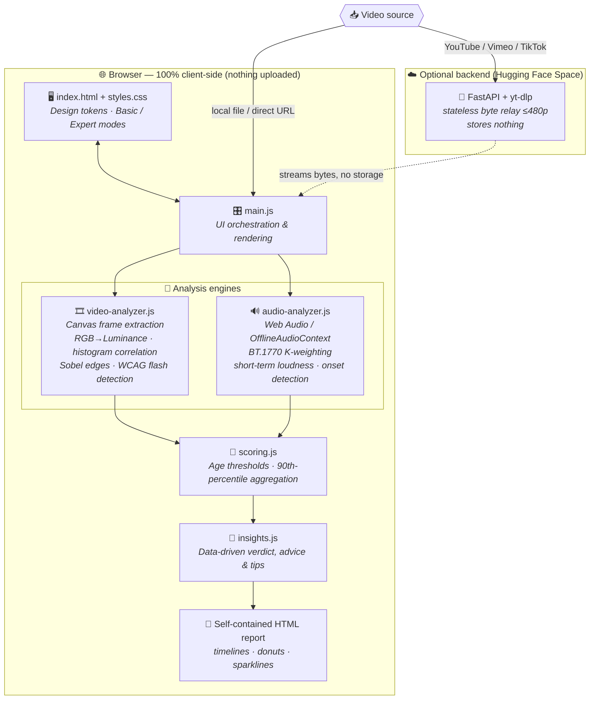

<div align="center">



### 🛡️ The world's first 100% client-side, science-grounded engine that quantifies **sensory overload** in children's media.

**Analyze any video in your browser and get a science-based age recommendation — without a single byte ever leaving your device.**
 
<br>

<!-- Hackathon badges -->
<a href="https://child-safety-in-ai.devpost.com"></a>


<br>


<br>

<!-- Technical badges -->


<br><br>


&nbsp;&nbsp;


<sub>⬆️ Drag & drop a video → get an objective, science-backed age verdict. Screenshots from the live app.</sub>

</div>

---

## 🏆 About this submission

> **This project was designed and built by [Daniyal Khan](https://github.com/digiflowhelp-stack) exclusively for the Devpost *Child Safety in AI* hackathon.** It is a purpose-built submission, not a repurposed project — every feature below was engineered within the hackathon window to answer the challenge brief.

| | |
|---|---|
| 🎯 **Hackathon** | [Child Safety in AI](https://child-safety-in-ai.devpost.com) |
| 🏫 **Hosted by** | STEMSisterz |
| 🗓️ **Build window** | **October 13, 2026 @ 6:00 AM GMT+5** → **October 15, 2026 @ 6:00 AM GMT+5** |
| ⏱️ **Deadline** | Oct 15, 2026 @ 6:00 AM GMT+5 |
| 👥 **Participants** | 48 |
| 🏅 **Prizes** | 🥇 $250 Winner · 🥈 $150 Runner-up (Amazon gift cards) |
| 🧭 **Category** | Machine Learning / AI · Beginner Friendly · Low/No Code |
| 👩⚖️ **Judge** | Chloe Lin |

### 🧩 Which challenge areas does Kiddometer address?

The brief asked for solutions to the sociotechnical challenges of protecting children in an age of AI. Kiddometer tackles **three** of the listed areas head-on:

| Challenge area from the brief | How Kiddometer delivers |
|---|---|
| ✅ **AI-powered content safety** — detect or filter harmful / age-inappropriate content | Automated **computer-vision + audio-signal analysis** flags sensory-toxic content that human ratings miss |
| ✅ **Parental and educator tools** — support safety *without* excessive surveillance | Fully **client-side**; parents get guidance from their *own* file, no accounts, no tracking, no data collection |
| ✅ **Trustworthy AI systems** — evaluate, audit, or improve the safety of AI products used by children | An **auditable, open-source, peer-reviewed-methodology** scoring engine anyone can inspect and re-run |

---

## 😵 The problem

Parents are told a video is "safe" because there's **no bad language and no violence** — but the things that actually reshape a toddler's developing brain are invisible to every traditional rating:

- 🔪 **Rapid scene cuts** every 1–3 seconds
- 🔊 **Sudden loudness spikes** ("jumpscares" and sound stings)
- ⚡ **Flashing and strobing** that breaches seizure-safety limits
- 🌈 **Extreme saturation and edge density** that overloads young visual systems

Age ratings like *TV-Y* and *PG* judge **plot and profanity**. They are blind to **sensory overload, hyper-pacing, and flashing**. Peer-reviewed research links fast-paced editing to measurable **executive-function deficits** in preschoolers — yet no consumer tool quantifies it.

**Kiddometer fixes that.**

---

## 💡 The solution

> ### "Current age ratings judge plot and profanity. Kiddometer quantifies the sensory signals that hijack early cognitive development — with zero cloud, zero uploads, and zero data leakage."

Drop in a video (MP4 / WebM / MOV), paste a direct URL, or use the optional YouTube tab. In roughly **¼ of the video's runtime**, Kiddometer decodes the audio-visual stream **entirely in your browser** and returns an objective, science-based age recommendation.

<div align="center">

### 🔒 Privacy by Architecture

**The video never leaves your device.** Decoding, frame inspection, and signal analysis execute 100% locally — eliminating COPPA and GDPR-K compliance risk by construction.

</div>

---

## 🔬 What it measures (and the science behind it)

Every score is traceable to an established, peer-reviewed standard. No subjective human opinion — **quantitative signal telemetry**.

| 📊 Metric | 🧠 What it detects | 📚 Scientific basis |
|---|---|---|
| **Visual cuts/min** | Shot-change frequency via luminance-histogram correlation | Lillard & Peterson (2011); Hinten et al. (2025) executive-function thresholds |
| **Flashes/s** | Per-zone luminance oscillations | **WCAG 2.3.1** photosensitive-seizure limit (3 flashes/s) |
| **Loudness peaks** | Short-term loudness jumps vs. programme average | **ITU-R BT.1770** K-weighting; EBU R128; WHO safe listening (<75 dB) |
| **Sound event density** | Salient audio onsets per minute | Christakis et al., *PNAS* (2018) |
| **On-screen motion** | Inter-frame luminance delta within shots | Calibrated heuristic |
| **Visual complexity** | Sobel edge density per frame | Calibrated heuristic |

### ⚙️ How the verdict is computed

1. The video is split into **60-second segments**.
2. Each segment gets the age band its **strictest metric** demands.
3. The global rating is the **90th percentile** across segments — *sustained* intensity decides, so a single outlier peak can't inflate or deflate the verdict (it's surfaced separately as an **intense moment**).
4. Any breach of the **3 flashes/s** limit always raises an explicit ⚠️ **photosensitivity warning**.

Age bands: `0–3` · `4–6` · `7–12` · `13+`

---

## 🏗️ Architecture

Kiddometer is a **zero-build, zero-dependency** vanilla-JS application. All heavy signal processing runs in-browser using native platform APIs — no WebAssembly blobs, no frameworks.



### 🧱 Component breakdown

| Module | Responsibility | Key techniques |
|---|---|---|
| `docs/js/main.js` | UI orchestration, source handling, rendering | `requestVideoFrameCallback`, drag & drop, view state |
| `docs/js/video-analyzer.js` | Cuts, motion, complexity, flashes | HTML5 Canvas, RGB→luminance, 32-bin histogram correlation, Sobel edge filter, 3×3 flash zones |
| `docs/js/audio-analyzer.js` | Loudness peaks, sound-event density | Web Audio API, `OfflineAudioContext`, BT.1770 K-weighted biquads (highpass + high-shelf), 400 ms short-term windows, energy-flux onsets |
| `docs/js/scoring.js` | Age thresholds & aggregation | 60 s windows, strictest-metric classification, 90th-percentile rollup, photosensitivity escalation |
| `docs/js/insights.js` | Human-readable verdict & guidance | Generated from the actual measurements |
| `docs/js/config.js` | Optional backend URL | Single line — empty disables the YouTube tab |

---

## ✨ Features

| | Feature |
|---|---|
| 🗂️ | **Three input sources** — local file, direct video URL, or YouTube/Vimeo/TikTok via the optional backend |
| 🖱️ | **Drop & scan** — drag a video in; analysis takes ~¼ of its duration |
| 🧒 | **Basic / Expert modes** — a plain verdict for parents, full charts for the curious |
| 📈 | **Rich diagnostics** — per-minute timeline, intense moments, distribution donut, per-metric sparklines |
| 📝 | **Downloadable report** — self-contained HTML with the full per-segment table |
| 🗣️ | **Data-driven copy** — verdict summary, advice and tips are generated from the real measurements |
| 🔐 | **Private by design** — analysis is 100% client-side; the optional backend only relays bytes and stores nothing |
| ⚡ | **Zero dependencies / no build step** — clone and serve |

---

## 🎯 Judging-criteria alignment

How Kiddometer maps to each weighted criterion:

| Criterion | Weight | Where Kiddometer scores |
|---|---|---|
| **Technical Execution** | **25%** | In-browser Canvas frame decoding, Web Audio API signal processing, and a zero-build vanilla-JS architecture — complex DSP (BT.1770 K-weighting, Sobel edge detection) implemented natively with no heavy WASM libraries |
| **AI Relevance** | **20%** | Automated computer-vision heuristics (luminance-histogram correlation, Sobel edge density) + automated audio feature extraction (short-term loudness, onset detection) replace manual review |
| **Usefulness** | **15%** | Gives parents instant, actionable age guidance *before* a child watches — no account, no upload, no waiting |
| **Impact** | **15%** | Zero-latency, 100% private, COPPA-compliant by design; scales to any browser on earth and into extensions, smart-TV firmware and school dashboards |
| **Creativity** | **15%** | Shifts content rating from subjective human review and text tags to **quantitative sensory-signal telemetry** |
| **Presentation** | **10%** | Clean Basic/Expert UI, self-contained report, and a concise demo walkthrough |

---

## 🚀 Try it

Open the app, drop a video, and wait roughly **¼ of the video's duration**. The video never leaves your device — decoding, audio analysis, and scoring all run in the browser.

```bash
git clone https://github.com/digiflowhelp-stack/Kiddometer
cd Kiddometer/docs
python -m http.server 8000
# → http://localhost:8000
```

No build step. No dependencies. Just a browser (Chromium-based recommended for full `requestVideoFrameCallback` support).

---

## 🧰 Tech stack

| Layer | Technology |
|---|---|
| **Frontend** | Pure HTML5 · CSS design tokens · Vanilla JavaScript (ES modules) |
| **Video analysis** | HTML5 Canvas API · `requestVideoFrameCallback` · luminance histograms · Sobel edges |
| **Audio analysis** | Web Audio API · `OfflineAudioContext` · ITU-R BT.1770 K-weighting · EBU R128-style loudness |
| **Scoring** | Custom 90th-percentile windowed aggregation engine |
| **Optional backend** | Python · FastAPI · yt-dlp · Docker (Hugging Face Spaces) |
| **Legacy reference** | Streamlit (`app.py`, `core.py`) |

---

## 📁 Project structure

```
Kiddometer
├── docs/                     # 🌐 Static web app (GitHub Pages)
│   ├── index.html            #    Home, analysis & methodology views
│   ├── assets/               #    Logo (SVG)
│   ├── css/styles.css        #    Design tokens (from design/desgin.pen)
│   └── js/
│       ├── main.js              # 🎛️ UI orchestration and rendering
│       ├── insights.js          # 🧠 Data-driven copy (verdict, advice, tips)
│       ├── video-analyzer.js    # 🎞️ Cuts, motion, complexity, flashes
│       ├── audio-analyzer.js    # 🔊 BT.1770 loudness, onset detection
│       ├── scoring.js           # 📐 Age thresholds and aggregation rules
│       └── config.js            # ⚙️ Optional backend URL
├── backend/                  # ☁️ Optional download helper (HF Space)
├── design/                   # 🎨 Pencil (.pen) design source
├── app.py / core.py          # 🕰️ Legacy Streamlit version
└── .github/screenshots/      # 🖼️ App screenshots
```

---

## ☁️ Optional backend (YouTube tab)

Streaming platforms don't allow fetching video files cross-origin, so the **YouTube tab** uses a small **FastAPI + yt-dlp** helper that streams the file to the browser (≤480p, **nothing stored**). It runs free on a Hugging Face Space and includes anti-bot layers for datacenter IPs: PO Token provider, Chrome TLS impersonation, a client fallback chain, and 12-hourly yt-dlp self-updates. Optional cookies act as the last layer.

Deploy guide: [`backend/DEPLOY_HF.md`](backend/DEPLOY_HF.md). Point `docs/js/config.js` at your Space and you're done. **Without a backend, everything else still works.**

---

## 🏷️ Tags

`#ChildSafety` `#ResponsibleAI` `#AIAct` `#COPPA` `#GDPR-K` `#PrivacyByDesign` `#ComputerVision` `#WebAudio` `#SignalProcessing` `#EdTech` `#DigitalWellbeing` `#SensoryOverload` `#WCAG` `#ITU-R-BT.1770` `#OpenSource` `#VanillaJS` `#ClientSideAI` `#STEMSisterz` `#Devpost` `#Hackathon`

---

## 🤝 Contributing

See [CONTRIBUTING.md](CONTRIBUTING.md). Issues and PRs welcome — especially **calibration data** for the heuristic thresholds.

## 📜 License

[MIT](LICENSE) — Kiddometer is an orientation tool; it does **not** replace the judgement of parents or professionals.

<div align="center">

---

**Built with ❤️ and a lot of ☕ by [Daniyal Khan](https://github.com/digiflowhelp-stack) for the [Child Safety in AI](https://child-safety-in-ai.devpost.com) hackathon (Oct 13 – Oct 15, 2026).**

<sub>🛡️ 100% local · 🚫 0 bytes uploaded · 📖 peer-reviewed methodology · 🌍 built for every child's browser</sub>

</div>
